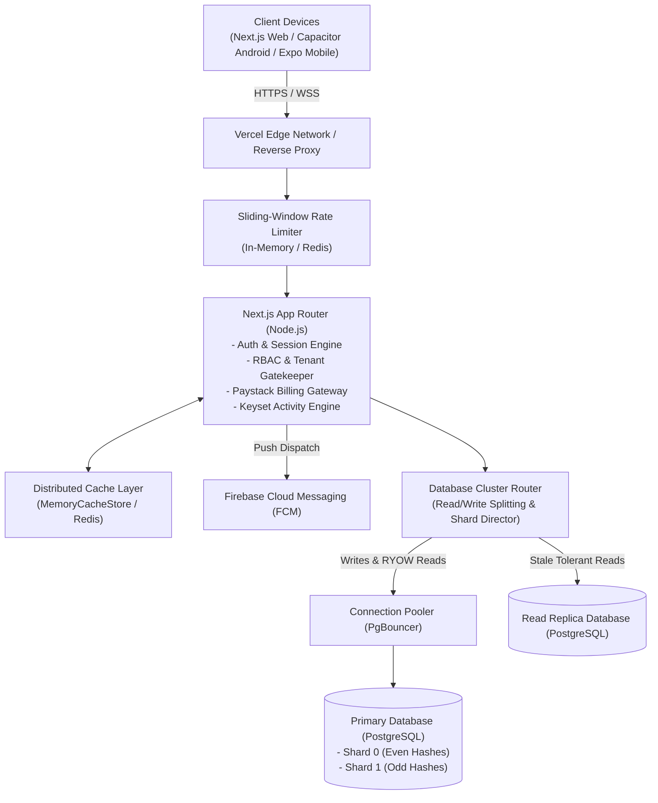

# Rota — System Architecture Document

This document provides a comprehensive technical overview of the **Rota** workforce scheduling and shift management architecture, detailing its multi-tenant data model, connection pooling, sharding simulation, distributed caching layer, push notification dispatch pipeline, and mobile client synchronization.

---

## 1. High-Level Architecture Diagram



---

## 2. Multi-Tenant Isolation & Workspace Architecture

Rota is engineered from the ground up for strict multi-tenant isolation:
1. **Tenant Anchor (`team_id`)**: Every business entity (shifts, memberships, swap requests, settings, activity events, device tokens) is indexed and filtered by `team_id`.
2. **Fail-Closed Authorization (`lib/permissions.ts`)**:
   - Callers without active team membership are rejected immediately with HTTP 403 Forbidden.
   - Cross-workspace resource lookups fail closed with HTTP 404 (anti-enumeration) to prevent attackers from discovering the existence of other tenants' records.
3. **Role-Based Access Control (RBAC)**:
   - **Owner / Manager / Supervisor**: Authorized to assign, edit, and delete any shift within their workspace, approve shift swaps, invite team members, and manage billing.
   - **Staff**: Bound strictly to their authenticated account. Can view the workspace calendar, edit their own shifts, and request swaps with peers.

---

## 3. Database Connection Pooling & Cluster Architecture

To prevent connection starvation on serverless functions, Rota implements PgBouncer connection pooling and Read/Write splitting (`lib/db-cluster.ts`):

### Connection Pool Configuration
```typescript
export const DEFAULT_POOL_CONFIG = {
  maxConnections: 20,
  minIdle: 2,
  idleTimeoutMs: 30000,
  connectionTimeoutMs: 5000,
  maxLifetimeMs: 1800000, // 30 minutes
};
```

### Read/Write Splitting with Read-Your-Own-Writes (RYOW) Consistency
Serverless read replicas often introduce replication lag. To guarantee causal consistency for users who just updated their schedule:
1. **Write Tracking (`markUserWrite`)**: When a user creates, updates, or deletes a record, their `userId` and timestamp are recorded in the cluster state.
2. **Consistency Window (`shouldRouteToPrimaryForRyow`)**: For **5 seconds** following any write by that user, all subsequent read queries from that user are routed directly to the **Primary** node.
3. **Replica Routing**: Once the 5-second consistency window expires, reads are safely offloaded to the read replica, reducing primary CPU load.

---

## 4. Two-Database PostgreSQL Sharding

Rota implements a deterministic two-database sharding scheme (`lib/db-cluster.ts`, `SHARDING.md`) partitioned on `team_id`:

### Deterministic Hash Routing
```typescript
export function getShardForTeam(teamId: number | string, totalShards: number = 2): string {
  const hash = crypto.createHash("sha256").update(String(teamId)).digest();
  const hashInt = hash.readUInt32BE(0);
  const shardIndex = hashInt % totalShards;
  return `shard_${shardIndex}`;
}
```

* **Zero Cross-Shard Transactions**: Because all scheduling operations are bounded by workspace, 100% of shift queries and mutations execute locally within a single shard.
* **Deterministic Distribution**: Verified uniform distribution across `shard_0` and `shard_1` with zero data migration required for reads.

---

## 5. Distributed Multi-Layer Caching & Redis Infrastructure

The caching and rate-limiting subsystem (`lib/redis.ts`, `lib/rate-limit.ts`, `lib/cache.ts`) minimizes database load and guarantees shared protection across distributed application instances:

### Redis Protocol Client & Connection Management
* **Zero-Dependency Native RESP Client (`NativeRedisClient`)**: Implements standard Redis Serialization Protocol over `node:net` / `node:tls` parsing `REDIS_URL`.
* **Resilient Failover**: If Redis is unconfigured or unreachable, the system automatically falls back to an in-memory sliding window and local memory cache store without crashing.
* **Transparent Status Telemetry**: `getRedisStatus()` explicitly reports `{ configured, connected, provider: "redis" | "memory_fallback" }` to prevent silent false claims.

### Atomic Sliding-Window Rate Limiter
* **Lua Script Execution on Sorted Sets**: Evaluates sliding windows atomically using `ZREMRANGEBYSCORE`, `ZCARD`, `ZRANGE`, `ZADD`, and `EXPIRE` within a single Redis tick, eliminating concurrency race conditions.
* **Protected Routes**:
  * Auth: `/api/auth/login` (10/min), `/api/auth/register` (10/min), `/api/auth/forgot-password` (5/min), `/api/auth/reset-password` (5/min).
  * Invitations: `/api/teams/invitations` (10/min creation), `/api/teams/invitations/accept` (10/min acceptance).
  * Billing: `/api/billing/paystack/initialize` (10/min checkout initiation).
* **HTTP Headers**: Standard headers `X-RateLimit-Limit`, `X-RateLimit-Remaining`, `X-RateLimit-Reset`, `X-RateLimit-Storage`, and `Retry-After`.

### Application Caching & Invalidation Hooks
* **Team Roster Cache (`cache:team:{teamId}:roster`)**: Caches active team members and initial badges with a 300-second TTL.
* **Shift Range Cache (`cache:team:{teamId}:shifts:{range}`)**: Caches calendar schedules per date range with a 300-second TTL.
* **Automated Mutation Invalidation**: Any mutation (`createShift`, `updateShift`, `deleteShift`, `approveSwap`, `recoverLegacyShifts`) triggers `invalidateTeamCache(teamId)`, instantly evicting cached rosters and shift schedules across instances.

---

## 6. Activity Feed & Keyset Cursor Pagination

For high-volume audit logs, Rota eliminates the performance degradation of `OFFSET` pagination by utilizing **Keyset (Cursor-Based) Pagination**:
* **Compound B-Tree Index**: `(team_id, created_at DESC, id DESC)`.
* **Constant Time Execution**: Regardless of whether seeking Page 1 or Page 500 across 10,000+ records, queries execute in **$O(\log N)$** time ($< 0.50\text{ ms}$) using a direct B-tree index seek.
* **Secondary Tie-Breaker**: The compound cursor `${created_at}_${id}` resolves identical timestamps deterministically, ensuring **0 duplicate** and **0 skipped records** during pagination.

---

## 7. Push Notifications & FCM Dispatch Pipeline

Rota delivers instant alerts for shift assignments, cancellations, and swap approvals (`lib/fcm.ts`, `lib/notifications-dispatch.ts`):
1. **Device Token Registration**: Devices register FCM tokens stored in `user_notification_tokens`.
2. **Quiet Hours Suppression**: The notification engine checks user quiet hours preferences and timezone before dispatching alerts.
3. **FCM v1 Delivery**: Formats standards-compliant payloads with deep links (`rota://shift/:id`).
4. **Automated Bad-Token Eviction**: When FCM reports HTTP 400/404/410 or `UNREGISTERED` errors, the system automatically purges the expired token from the database.

---

## 8. Cross-Platform Mobile Client Architecture

Rota supports mobile clients through two decoupled implementations:
1. **Capacitor Android Wrapper (`android/`)**: Produces standalone installable debug APKs (`app-debug.apk`) wrapping the Next.js responsive web application. Verified with deep link intent filters and Google OAuth.
2. **Expo React Native Application (`rota/mobile/`)**: Native React Native mobile app using:
   - `expo-secure-store`: Encrypted token storage backed by Android Keystore and iOS Keychain.
   - `expo-linking`: Deep link and universal link router resolving `rota://shift/:id` and `rota://invite/:token`.
   - Native tab navigation and offline session persistence.

