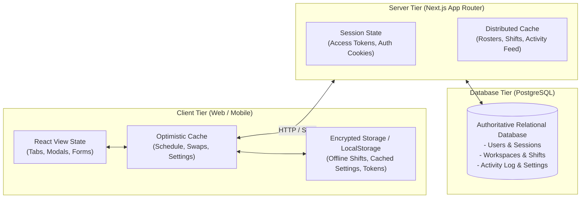

# Rota — State Management & Synchronization Architecture

This document specifies the state model, session lifecycle, offline synchronization mechanisms, optimistic updates, and cross-device conflict resolution algorithms in the **Rota** application.

---

## 1. State Topology Overview

Rota divides application state across three primary tiers:



---

## 2. Authentication & Session State Lifecycle

### Token Lifecycle & Expiration
* **Short-Lived Access Token**:
  - Format: Stateless HMAC-SHA256 signed JWT-style token.
  - TTL: **15 minutes** (`ACCESS_TOKEN_TTL_SECONDS = 900`).
  - Storage: `rota_session` cookie (`HttpOnly`, `SameSite=Lax`, `Secure`).
  - Payload: `{ userId, email, name, role, teamId, sessionId, exp }`.
* **Long-Lived Refresh Token**:
  - Format: Cryptographic secret (`sess_<uuid>.<secret>`).
  - TTL: **7 days** (`REFRESH_TOKEN_TTL_SECONDS = 604800`).
  - Storage: `rota_refresh` cookie.
  - Server Record: Stored in `auth_sessions` table with SHA-256 hashed secret.

### Refresh Token Rotation (RTR) & Automatic Reuse Detection
To prevent refresh token theft:
1. Every successful token refresh rotates both the access token and refresh token secret.
2. The old refresh token hash is moved to the `used_refresh_tokens` ledger.
3. **Theft Detection**: If a client submits a token already present in `used_refresh_tokens`, the server identifies a token replay attack and **immediately revokes the entire family of sessions** (`WHERE family_id = ${familyId}`).

---

## 3. Offline Resilience & Schedule Sync

### Local Storage Schema
When authenticated, shift schedules and user preferences are mirrored to client storage:
* `rota_cached_schedule_shifts_v1`: Contains enveloped shift records with `userId`, `teamId`, and `timestamp`.
* `rota_cached_schedule_timestamp_v1`: Stores the ISO timestamp of the last successful synchronization.
* `rota_cached_user_settings_v1`: Stores user theme, language, and notification preferences.

### Offline Detection & Schedule Banner
When a network failure or disconnected state occurs:
1. `loadShifts()` intercepts the error and checks `loadShiftsFromOfflineCache()`.
2. If cached records matching the authenticated user and workspace exist, they are displayed instantly.
3. The UI renders the **Offline Resilience Active** warning banner:
   ```text
   ⚠️ Offline Resilience Active: Displaying cached schedule from local storage.
   Last updated: 15:42:10
   ```
4. On logout or workspace switch, all cached records are purged immediately to prevent data leakage across accounts on shared devices.

---

## 4. Optimistic Updates & Atomic Rollback

To maintain an instantaneous user experience, user actions update client state optimistically before network requests resolve:

### Shift Swap Approval Rollback
```typescript
async function handleApproveSwap(swapId: number) {
  // 1. Snapshot previous state
  const previousSchedule = [...schedule];
  const previousSwapRequests = [...swapRequests];

  // 2. Optimistically update local view
  setSwapRequests((prev) => prev.map((r) => r.id === swapId ? { ...r, status: "approved" } : r));
  // Swap employee assignments in schedule immediately...

  try {
    const res = await fetch(`/api/shifts/swaps/${swapId}/approve`, { method: "POST" });
    if (!res.ok) throw new Error("Approval failed");
    await loadShifts();
  } catch (err) {
    // 3. Roll back to snapshot on error
    setSchedule(previousSchedule);
    setSwapRequests(previousSwapRequests);
    setError("Could not approve shift swap. Changes reverted.");
  }
}
```

### User Settings Synchronization Rollback
When a user alters theme, quiet hours, or language:
1. Snapshot current settings.
2. Apply changes immediately to UI and document root (`applyThemeToDocument`, `applyLanguageToDocument`).
3. Send PUT request to `/api/settings`.
4. If a revision conflict (HTTP 409) or network failure occurs, revert to the snapshot and display a conflict resolution prompt.

---

## 5. Cross-Device Settings Synchronization & Conflict Resolution

User preferences are synchronized server-side across all signed-in devices using **optimistic concurrency control**:

### Conflict Resolution Algorithm
1. Every settings row in `user_settings` maintains a monotonically increasing integer `revision` and a timestamp `updated_at`.
2. When Device A saves settings, it transmits its known `expectedRevision`.
3. If Device B has already updated the settings in the interim, the server detects:
   ```typescript
   if (incomingRevision !== serverSettings.revision && !force) {
     return {
       status: 409,
       conflict: true,
       serverSettings,
       message: "Settings conflict detected: Another device updated your settings.",
     };
   }
   ```
4. **Resolution Options**:
   - **Accept Server Settings**: Overwrite local cache with authoritative `serverSettings`.
   - **Force Overwrite**: Resubmit update with `force: true` to authoritatively overwrite server settings and increment the revision number.

