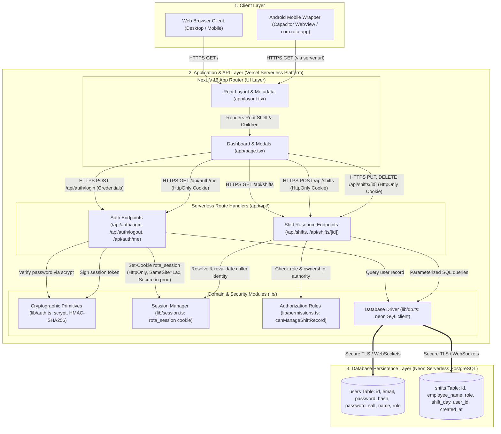

# Rota — System Architecture & Component Diagram

* **Project:** Rota (Shift Scheduling & Workforce Management)
* **Production URL:** [https://rota-lovat-gamma.vercel.app/](https://rota-lovat-gamma.vercel.app/)
* **Repository:** `rota/web`

---

## 1. System Architecture Diagram

---

## 2. Major Component Explanations

### 1. Client Layer
* **Web Browser Client:** Standard desktop and mobile web browsers accessing the application over HTTPS at `https://rota-lovat-gamma.vercel.app/`.
* **Android Mobile Wrapper (`com.rota.app`):** An Android application built with Capacitor v8. It wraps the responsive Next.js web application inside an Android WebView, configuring `server.url = 'https://rota-lovat-gamma.vercel.app/'` and `androidScheme = 'https'`. Because it accesses the live production site directly, it requires an active network connection and shares the identical server-rendered interface.

### 2. Application & API Layer (Vercel Serverless Hosting)
* **Next.js App Router (`app/layout.tsx`, `app/page.tsx`):**
  * `app/layout.tsx`: Root layout defining the global HTML document structure, fonts, and metadata; renders the root shell and mounts child components.
  * `app/page.tsx`: Serves the main workforce dashboard, schedule grid, roster view, and client-side modal states for shift creation, editing, deletion, and sign-in.
  * Implements responsive navigation, statistics computation (total shifts, active team on shift, assigned members), and read-only fallback displays when unauthenticated.
* **Authentication Route Handlers (`app/api/auth/*`):**
  * `POST /api/auth/login`: Validates email and password, verifies credentials against stored `scrypt` hashes, generates a signed HMAC-SHA256 session token, and sets the `rota_session` cookie.
  * `POST /api/auth/logout`: Clears the session cookie by issuing an immediate expiration.
  * `GET /api/auth/me`: Inspects the active cookie and returns sanitized user profile information (`id`, `email`, `name`, `role`) without disclosing secrets or password hashes.
* **Shift Route Handlers (`app/api/shifts/*`):**
  * `GET /api/shifts`: Publicly readable endpoint returning active shifts ordered by `shift_day ASC, id ASC`.
  * `POST /api/shifts`: Authenticated endpoint. Revalidates session user against the database and assigns shift ownership (`user_id`). Managers may schedule on behalf of other staff.
  * `GET /api/shifts/[id]`: Retrieves a single shift record by ID. (Note: Implemented on the server, but the current frontend UI does not invoke this endpoint; it searches the already-loaded shift list in client state instead).
  * `PUT /api/shifts/[id]`: Authenticated update. Enforces strict ownership checks (`canManageShiftRecord`).
  * `DELETE /api/shifts/[id]`: Authenticated deletion. Enforces strict ownership checks (`canManageShiftRecord`).

### 3. Domain & Security Modules (`lib/`)
* **`lib/auth.ts`:** Implements Node.js native cryptographic utilities (`crypto.scrypt` with unique 16-byte random salts and constant-time `timingSafeEqual` comparison; `crypto.createHmac` for signed session tokens).
* **`lib/session.ts`:** Manages the `rota_session` cookie options (`httpOnly: true`, `secure: process.env.NODE_ENV === "production"`, `sameSite: "lax"`, `path: "/"`). The `secure` flag is enabled in production over HTTPS and disabled during local development. Provides `getSessionUser({ revalidateWithDb: true })` to verify that the session user still exists in PostgreSQL and possesses an up-to-date role.
* **`lib/permissions.ts`:** Implements the server-side authorization matrix (`canManageShiftRecord`):
  * Unauthenticated callers are rejected.
  * Managers (`Supervisor`, `Operations`, `Admin`) possess workspace-wide authority to edit or delete any shift.
  * Standard staff members can only modify shifts matching their exact `user_id`.
  * Legacy shifts (`user_id IS NULL`) are protected and cannot be claimed by ordinary employees even if employee names match.
* **`lib/db.ts`:** Initializes the Neon serverless PostgreSQL client via `@neondatabase/serverless` using the environment-injected `DATABASE_URL`.

### 4. Database Persistence Layer (Neon PostgreSQL)
* **`users` Table:** Stores identity and authentication records: `id` (serial primary key), `email` (unique, lowercase), `password_hash` (hex), `password_salt` (hex), `name` (varchar), and `role` (varchar).
* **`shifts` Table:** Stores workforce scheduling records: `id` (serial primary key), `employee_name` (varchar), `role` (varchar), `shift_day` (date), `user_id` (integer foreign key referencing `users(id)`), and `created_at` (timestamp with time zone).

---

## 3. Core Data & Request Flows

### Flow A: User Authentication & Session Issuance
1. The user enters email and password into the sign-in modal in `app/page.tsx`.
2. The browser sends `POST /api/auth/login` with JSON payload `{ email, password }`.
3. The server normalizes the email, retrieves the corresponding `users` row from PostgreSQL, and computes the scrypt hash with the row's salt.
4. If valid, the server creates an HMAC-SHA256 signed session token containing `{ userId, email, name, role }` signed with `AUTH_SECRET`.
5. The response returns HTTP 200 with sanitized user profile and sets the `Set-Cookie: rota_session` header (`HttpOnly; SameSite=Lax; Secure in production when NODE_ENV === "production"`).

### Flow B: Shift Listing & Public Overview
1. When loading `app/page.tsx`, the client dispatches a `GET /api/shifts` request.
2. The route executes parameterized SQL: `SELECT ... FROM shifts ORDER BY shift_day ASC, id ASC`.
3. The server returns JSON array of shifts to the client.
4. Client components compute team capacity metrics and render the weekly schedule grid.

### Flow C: Authorized Shift Creation & Modification
1. An authenticated user submits a new shift or edits an existing shift.
2. The client sends `POST /api/shifts` or `PUT /api/shifts/[id]` with the `rota_session` cookie attached.
3. The route handler calls `getSessionUser({ revalidateWithDb: true })`, reading the cookie and verifying the HMAC signature with `AUTH_SECRET`.
4. For modifications, the server fetches the target shift and evaluates `canManageShiftRecord(sessionUser, targetShift)`.
5. If authorized, the parameterized query (`INSERT INTO ...` or `UPDATE ...`) is executed against Neon PostgreSQL, and the updated record is returned with HTTP 200/201.

---

## 4. Architectural Boundaries & Verified Constraints

* **Stateless Serverless Execution:** Next.js route handlers run as ephemeral serverless functions on Vercel. Session state is not stored in server memory; it is maintained cryptographically via signed cookies and revalidated against the database.
* **No Caching / Queuing Layers:** The application communicates directly with Neon PostgreSQL. No external Redis cache, background message queue (e.g. RabbitMQ/Kafka), or worker processes exist in the codebase.
* **Database Secrets Isolation:** All database transactions occur strictly within Vercel serverless functions. Database connection strings (`DATABASE_URL`) and cookie signing keys (`AUTH_SECRET`) are never exposed to the client or Android bundle.
* **Android Remote-Server Model:** The Android APK does not bundle an offline SQLite/Room database or local Node.js runtime. It operates purely as a secure WebView wrapper communicating with `https://rota-lovat-gamma.vercel.app/` over HTTPS.
